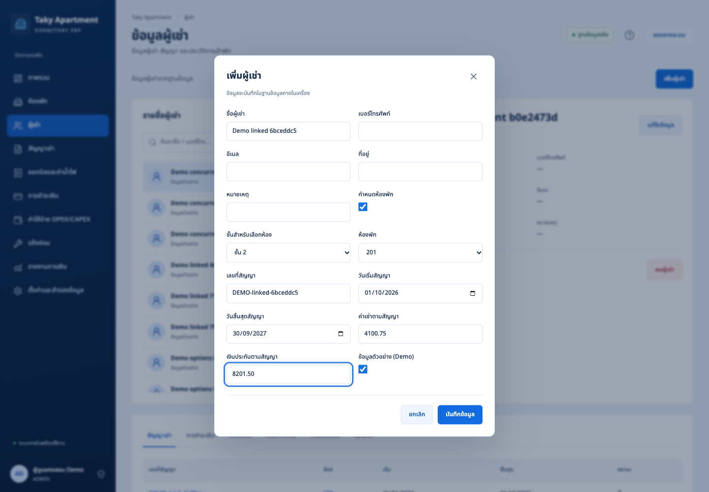
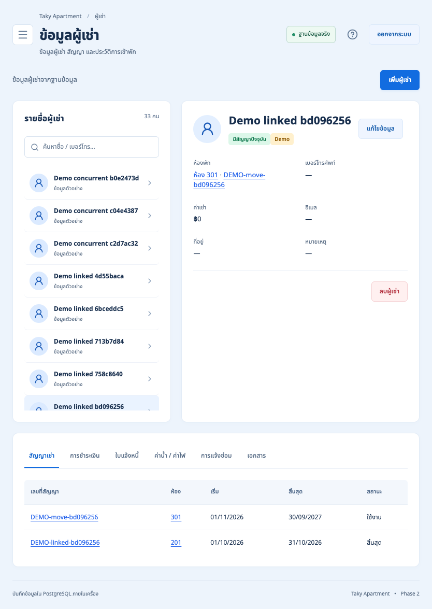
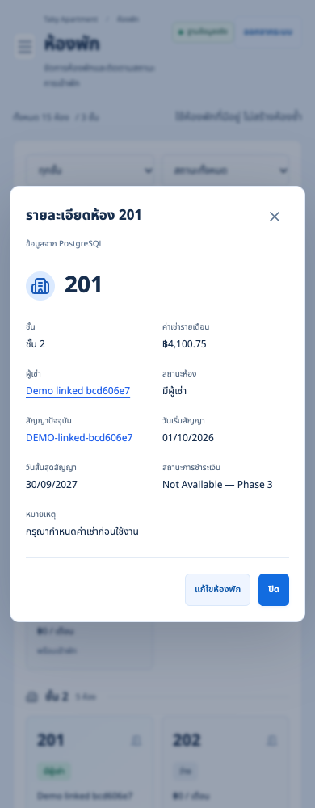

# Phase 2.6 implementation and verification report

Review date: 17 October 2026. Repository: private `ramajittilearn-ctrl/ERP-TakyApartment`. Branch: `main`. Baseline: `ef39ff35f5ca9f0ae1edd38ce4f26f9ecbe6e10d`.

## Executive summary

Rooms, tenants and leases now share one assignment workflow through the existing Lease relationship. Operators can create an unassigned tenant or save a tenant and a complete ACTIVE lease atomically. The editor supports updates to the current lease and an explicit room transfer that ends the previous lease and retains its history. Room, tenant and lease profiles link to each other.

Occupancy is derived from ACTIVE leases. Operational room availability is AVAILABLE, RESERVED or MAINTENANCE. Payment status is explicitly `Not Available — Phase 3`; no billing, invoice generation or payment processing was added. The approved Thai interface, navy sidebar, white cards and responsive layouts remain.

Status: Phase 2.6 implementation and isolated deployment verification are complete. Final host/Docker builds, TypeScript, lint, formatting, 28 unit tests, eight backup/security unit tests, 19 PostgreSQL integration tests and 41 browser tests passed. Restart persistence and five HTTPS/backup operational checks also passed. No unresolved implementation blocker remains. The normal deployment and original port-3300 demonstration were intentionally not upgraded by these tests; their rollout and inherited owner commissioning remain separate tasks.

## Scope completion matrix

| Feature | Status | Relevant files | Acceptance and evidence |
| --- | --- | --- | --- |
| Existing project/history review | Complete | `docs/phase-2.6-plan.md` | Clean main baseline, existing services, routes, schema, tests and deployment inspected. GitHub is private and main matched the baseline. |
| Optional floor/room assignment on tenant create/edit | Complete | `src/features/live/editor.tsx`, `src/server/validation.ts`, `services.ts` | PostgreSQL room records populate dependent selectors. Tenant-only and assigned creation tested. |
| Atomic profile and lease save | Complete | `services.ts`, `lease-service.ts` | Serializable transaction contains profile, lease and audit changes; invalid/occupied/duplicate assignments and failed transfers roll back. |
| Existing assignment update | Complete | Editor, services | Current lease ID is checked against the database; updating rent does not create another lease. Profile-only updates do not clear an assignment. |
| Explicit transfer and historical leases | Complete | Editor, services, lease service | Operator supplies a new contract and previous end date and confirms. Old room/tenant/financial terms remain on the ended lease. New start must follow previous end. |
| Floor-dependent room selectors | Complete | Editor, `tests/phase2/phase26.spec.ts` | Real rooms 101–105, 201–205, 301–305; room selection resets after a floor change. Occupied and reserved rooms excluded, current assignment retained. |
| Available/Occupied/Reserved/Maintenance | Complete | Room UI, contracts, Prisma schema and two new migrations | Occupied comes from ACTIVE Lease; PostgreSQL triggers and service checks reject incompatible operational status. Saving AVAILABLE does not end a lease. |
| Preserve 15 seeded rooms | Complete | Room UI, services, existing seed | No UI room creation/deletion; existing identities cannot be renumbered/moved; seeded principal rooms cannot be deleted through the service. Existing unique constraint prevents duplicates. |
| Room profile integration | Complete | `src/features/live/rooms.tsx` | Floor, occupancy, linked tenant and lease, dates, authoritative lease rent and unavailable payment status exercised in browser tests. |
| Tenant/lease profile navigation | Complete | Tenants/leases UI, three route pages, repository | Deep links use `?tenant=`, `?room=` and `?lease=`; browser creation redirects to the saved tenant profile. Tenant GET includes lease room records. |
| Authentication, authorization and audits | Complete | Existing auth/HTTP handlers, services | Existing login, session, CSRF, STAFF/ADMIN, audit immutability and CRUD regressions pass. Assignment uses the same protected APIs. |
| Responsive and existing UI regression | Complete | Existing browser suite, Phase 2.6 suite, screenshots | Final image: 41/41 browser tests, including 36 existing tests and five new tests, zero skipped/flaky/unexpected results. |
| Docker persistence and backup compatibility | Complete | `scripts/verify-persistence.mjs`, `verify-phase26.mjs` | Final Docker startup, database/session/attachment restart persistence, HTTPS and encrypted new-schema backup/restore all passed. |
| Phase 3 billing/payment processing | Not Started | Display-only `payment-status.ts` | Intentionally excluded. Future display labels cover Paid, Unpaid, Partial and Overdue; no financial status is fabricated. |

## Technical architecture and database changes

The existing Next.js 16 App Router, React 19, Prisma 7 and PostgreSQL 17 architecture remains. Protected generic CRUD route handlers validate JSON and origin, authorize the session actor and call services. Services own transactions and business rules; the repository owns profile/list queries. `lease-service.ts` centralizes lease validation for both standalone lease CRUD and tenant assignment.

Relationships remain Property → Floor → Room → Lease ← Tenant. Lease owns room assignment and contract amounts/dates. No tenant-room column, relationship table or duplicate occupancy field was added. Existing deposit, meter, utility, invoice, payment/allocation, expense, maintenance, user/role, attachment, audit and backup models remain unchanged.

Two additive migrations were added:

- `202610170002_room_reserved` adds RESERVED to RoomStatus.
- `202610170003_occupancy_integrity` adds `active_lease_room_guard` and `occupied_room_status_guard`. An ACTIVE lease must reference an operationally available room; an occupied room cannot become reserved or maintenance.

The existing partial unique index `Lease_one_active_room`, room floor/number uniqueness, UUID foreign keys, date/nonnegative checks, DECIMAL(14,2) contract amounts and append-only audit safeguards remain. All original migration files are preserved. Room occupancy is a lifecycle state from ACTIVE leases, not a timer based on today's date.

Authentication remains local Argon2id passwords, opaque database-backed sessions and ADMIN/STAFF authorization. There are no new credentials or authentication bypasses. Assignment amounts remain validated decimal strings and Prisma Decimal values; no floating-point arithmetic was added. Contractual deposits are not represented as received cash.

The deployment remains Caddy HTTPS → Next.js → private PostgreSQL, with persistent database and attachment volumes and the existing operations scheduler. Tests use the separate `taky-phase26-test` project and volumes, initially localhost:3400 HTTP, then localhost:3543 HTTPS. No public interface or database port is opened.

## Implementation details

Created:

- `src/server/lease-service.ts`; `src/features/live/payment-status.ts`.
- The two migration directories listed above.
- `tests/integration/room-assignment.test.ts`, `tests/phase2/phase26.spec.ts`, `tests/payment-status.test.ts`.
- `scripts/verify-phase26.mjs`, `docs/phase-2.6-plan.md`, `docs/phase-2.6-verification.json`, this report and nine Demo-only screenshots under `docs/phase-2.6-screenshots/`.

Modified:

- `prisma/schema.prisma`, `src/server/services.ts`, `repository.ts`, `validation.ts`.
- `src/features/live/editor.tsx`, `contracts.ts`, `rooms.tsx`, `tenants.tsx`, `leases.tsx`.
- `src/app/(erp)/rooms/page.tsx`, `tenants/page.tsx`, `leases/page.tsx`, and `src/app/globals.css`.
- `tests/phase2/app.spec.ts`, `playwright.config.ts`, `scripts/verify-persistence.mjs`, `.dockerignore`, `README.md`.

API paths are unchanged. `POST /api/v1/tenants/` and `PUT /api/v1/tenants/:id/` now accept an optional strict `assignment` object with roomId, contract number, dates, rent and deposit. A current assignment supplies leaseId; a transfer additionally supplies previousEndDate. Omitting assignment changes only the profile. Existing room, floor, property and lease endpoints retain their authentication/RBAC and CRUD contract, with stronger room identity and occupancy checks.

The small-property UI edits existing room inventory; ADMIN configuration APIs still support non-seeded inventory for existing integrations. Legacy tenants with multiple ACTIVE leases can edit their profile but must manage those contracts in Lease Management rather than allowing the tenant form to choose one implicitly.

## Testing and verification

Docker commands below use the installed Docker Desktop CLI with its local socket and existing private configuration. `C26` denotes the executed Compose prefix `--env-file .env.test -p taky-phase26-test -f docker-compose.yml -f docker-compose.test.yml`. HTTP startup uses `APP_PORT=3400 APP_ORIGIN=http://127.0.0.1:3400`. See README for reproducible commands.

| Test | Command executed | Result | Actual evidence |
| --- | --- | --- | --- |
| Prisma client generation | `npm run db:generate` | PASS | Prisma Client 7.10.1 generated. |
| TypeScript | `npm run typecheck` | PASS | No type errors. |
| Lint | `npm run lint` | PASS | Zero warnings/errors. |
| Formatting and patch whitespace | `npm run format:check`; `git diff --check` | PASS | Final source checks clean after formatting. |
| Host production build | `npm run build` | PASS | Optimized Next.js build, TypeScript, route generation and static pages completed. |
| Unit tests | `npm test` | PASS | 28 tests: existing finance/lease summaries and five future payment display labels. |
| Backup/security unit tests | `npm run test:ops` | PASS | 8 encryption, tamper, path, retention, schedule and restore-confirmation tests. |
| Existing and assignment database integration | Initial corrected fixture run: `C26 run --rm --no-deps -v "$PWD/tests:/app/tests:ro" app npm run test:integration`; final: `C26 exec -T app npm run test:integration` | PASS | Final image: 19 tests against real PostgreSQL, including nine new assignment tests. |
| Browser regression | `PLAYWRIGHT_BASE_URL=http://127.0.0.1:3400 SCREENSHOT_DIR=tmp/phase26/screenshots npm run test:e2e` | PASS | Final 41/41 in 101.956 seconds, zero skipped/flaky/unexpected. Existing accessibility/smoke at 1440/768/390px and new linked-profile/transfer flows at 1440/834/390px. |
| Final Docker image build | Build stage of `C26 up -d --build --wait` | PASS | Final production image exported successfully as `sha256:ab4dc63c0c05a4a20fcfb18ad0e3091a7894bec44dfb539844606bab1c88fce8`. |
| Final Docker startup | Startup stage of `C26 up -d --build --wait` | PASS | Docker recovered without a restart; the final app and database reached healthy state and Compose exited 0. |
| Final migration status and schema drift | `C26 exec -T app npx prisma migrate status`; `C26 exec -T app npx prisma migrate diff --from-config-datasource --to-schema prisma/schema.prisma --exit-code` | PASS | Rerun on the final healthy container: all five migrations applied; no Prisma schema difference, exit 0. The earlier attempts failed during container replacement. Triggers and SQL constraints were tested separately. |
| Restart persistence | `TEST_PROJECT=taky-phase26-test PLAYWRIGHT_BASE_URL=http://127.0.0.1:3400 node scripts/verify-persistence.mjs` with HTTP startup variables | PASS | Room/tenant/lease fingerprints, all 15 rooms, authenticated session and private attachment marker survived app/database restarts. Only the test marker was removed. |
| HTTPS, private ports, backup/restore | `node scripts/verify-phase26.mjs` | PASS | Five runtime checks; trusted Caddy CA, Secure/HttpOnly/SameSite cookies, exact-origin rejection, no app/DB published ports, five migrations, encrypted backup and automatic isolated PostgreSQL restore. Sanitized evidence saved in `docs/phase-2.6-verification.json` at 08:21:07 UTC. |
| Normal deployment isolation | Read-only PostgreSQL count query | PASS | Normal DB still has 15 rooms, zero tenants, zero leases and three original migrations. No normal deployment migration performed. |

An initial integration run had seven failures because its newly generated test lease number was 41 characters, exceeding the existing 40-character validation limit. The fixture was corrected, not the production validation. Rerun passed all 19 tests. Interim formatting failures were corrected and checks rerun.

Docker Desktop temporarily stalled during final container replacement. Early migration-status/drift attempts failed because the replaced container was not running; daemon and health-check requests also timed out. Docker recovered without a global restart or volume deletion. Final Compose startup, migration status/drift, all 19 integration tests, all 41 browser tests, restart persistence and subsequent HTTPS recreation/backup passed. Both original demo and new HTTP health endpoints returned 200 after recovery. The cause of the runtime stall was not established. No failed attempt is represented as a pass without an executed rerun.

Browser plugin was not available; the repository's regular Playwright/Chrome workflow was used. Browser tests assert navigation, field values, occupancy, lease history, refresh persistence, no horizontal document overflow and no relevant page/console errors in the new flows. Screenshots are Demo-only. Visual review retained the approved layout; profile links use a visible blue underline and form checkboxes use a normal compact size. Modal screenshots capture the actual viewport rather than unshaded off-screen page content.

## Security and data integrity

- Profile, lease and sensitive audit writes share one SERIALIZABLE transaction. Row locks and the existing unique active-room index protect competing assignments. Conflict responses require an operator reload/retry; they do not silently overwrite another assignment.
- Server checks validate room availability, real calendar dates, date order, transfer dates, lease identity/history, decimal precision and Demo consistency. Database triggers also reject incompatible room/ACTIVE lease changes through direct SQL.
- Room status never implicitly ends a lease. Deletion restrictions and foreign keys preserve referenced records; transfers retain the old contract's room, tenant, number and financial values.
- Existing passwords, sessions, origin checks and role restrictions remain. Secrets are environment-based. Test credentials, backup keys, certificates, database volumes, attachment markers and encrypted archives are ignored and must not be committed.
- Phase 2.5 encrypted backup/restore verification passed for the new schema and linked records. The verified encrypted archive was 33,582 bytes; checksum and verification time are in the sanitized JSON evidence. No archive, key or database dump is committed. Google Drive authorization/upload, owner key escrow and physical additional-device certificate trust remain owner commissioning tasks, not proof of off-device recovery.
- Unique contract numbers and the active-room index prevent duplicate assignments. A general HTTP idempotency-key mechanism was not added; Phase 3 financial posting must define that separately.

## Issues, limitations and rollout

| Severity | Issue or limitation | Disposition |
| --- | --- | --- |
| High before live financial use | Off-device Google Drive upload, key escrow, normal first-admin commissioning and additional-device CA trust are inherited manual prerequisites. | Not tested or claimed complete in this phase; follow existing backup/LAN guides. |
| Medium | Docker Desktop runtime stall occurred during container replacement; root cause is unknown. | Recovered without a global restart. Every final runtime check subsequently passed. Inspect Docker Desktop health during normal rollout; no application-code cause or data loss was demonstrated. |
| Medium | Normal deployment and the original localhost:3300 demo intentionally remain on the previous phase. | Upgrade through the existing backup-first HTTPS deployment workflow after review. No normal records were replaced. |
| Low | Lease activation/ending is manual; date passage does not schedule state changes. One ACTIVE lease per room is enforced even for non-overlapping dates. | Intentional small-property lifecycle rule. |
| Low | Multiple pre-existing ACTIVE leases for one tenant require Lease Management for assignment edits. | Profile editing and all historical records remain accessible. |
| Low | Browser coverage is local Chrome with desktop/tablet/mobile viewport sizes, not physical Safari/iPhone or another LAN device. | Physical-device commissioning remains manual. |

## Phase 3 readiness recommendation and stop point

Do not begin Phase 3 without approval and an independent review of this commit. First review tenant transfers and occupancy invariants, perform a verified backup before normal rollout, and finish off-device recovery/key/certificate commissioning. Then define billing periods, tariff effective dates, exact-decimal invoice calculation, invoice immutability, payment allocation/idempotency and reversals before adding financial workflows.

Phase 2.6 meets its implementation acceptance criteria in the isolated Docker deployment. No Phase 3 implementation is included. The delivered commit is a direct child of the inspected baseline, without a force update or history rewrite; its hash and remote-ref confirmation accompany delivery.

## Screenshot evidence

The nine screenshots cover tenant assignment, room detail and transferred tenant profiles at 1440, 834 and 390 pixels. Representative final-image captures:

